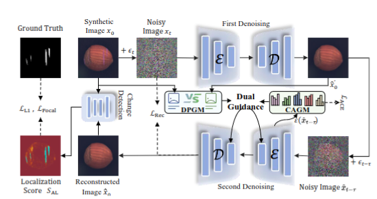

# DGDM





 
## Get Started 

### Environment 
```bash
pip install -r requirements.txt
```

### Data

#### MvTec-AD
Download the dataset from [here](https://www.mvtec.com/company/research/datasets/mvtec-ad/).

#### VisA
Download the dataset from [here](https://amazon-visual-anomaly.s3.us-west-2.amazonaws.com/VisA_20220922.tar).


```

MVTec-AD
|-- carpet
|-----|----- thresh
|-----|----- ground_truth
|-----|----- test
|-----|--------|------ good
|-----|--------|------ ...
|-----|----- train
|-----|--------|------ good
|-- cable
|-----|----- DISthresh
|-----|----- ground_truth
|-----|----- test
|-----|--------|------ good
|-----|--------|------ ...
|-----|----- train
|-----|--------|------ good

VisA
|-- candle
|-----|----- DISthresh
|-----|----- ground_truth
|-----|----- test
|-----|--------|------ good
|-----|--------|------ bad
|-----|----- train
|-----|--------|------ good
|-- capsules
|-- ...

```

## Inference
Please specify the dataset path MVTec-AD and checkpoints path, To perform inference with checkpoints, please run:
```bash
python main.py
```

## 📁 checkpoints Links

| Dataset   | Google Drive | Baidu Drive     |
|-----------|--------------|-----------------|
| MVTec-AD  | [Download](https://drive.google.com/file/d/1Ag-Gs8pth00m5-1Yk-sEYHvaSB1zFTCh/view?usp=drive_link) | Download (Soon) |
| Real-IAD  | [Download](https://drive.google.com/file/d/1vu-6rmiCrPad_7MW0USpQkvtROv-g0ZO/view?usp=sharing) | Download (Soon) |
